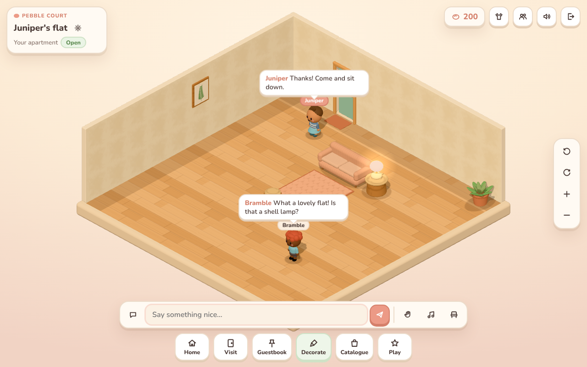
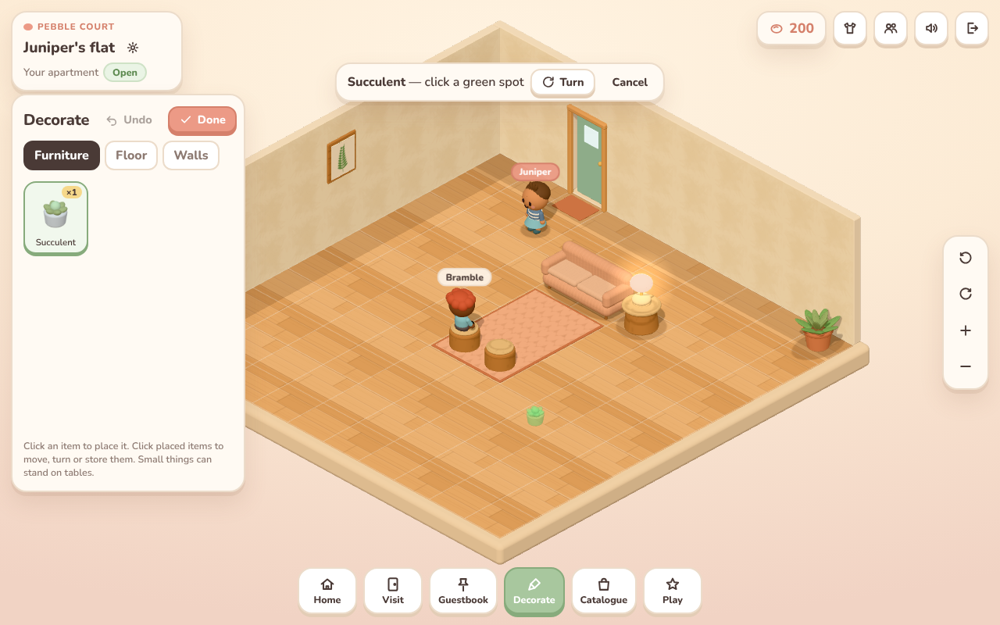
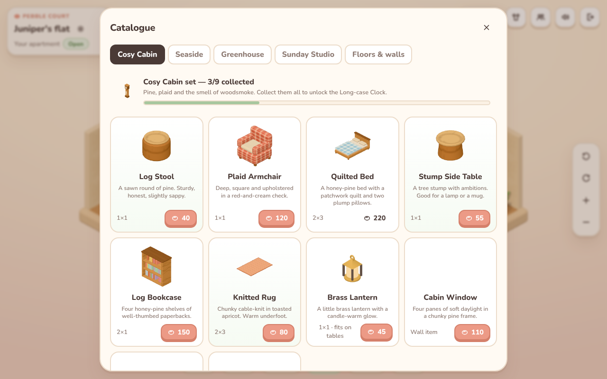

# Pebble Court

A small, cosy, browser-based social game. Every player gets a flat in the same block: they decorate it, drop in on the neighbours, chat in speech bubbles and leave notes on each other's pinboards. Furniture and floor and wall materials come from a catalogue paid for in **pebbles**, which you earn by playing quizzes and a memory game. Some pieces can't be bought at all, so a visitor who spots a pot-bellied stove knows someone aced the pub quiz.

Everything you see is built in code: the furniture is assembled from rounded primitives, the textures are drawn on canvases, the sounds are synthesised, and the icons are hand-written SVG paths. There are no external art, audio or font CDNs. Nunito is bundled from npm.



## Running it

You need **Node 22.13 or newer**, because the server uses Node's built-in SQLite (`node:sqlite`) and needs no native modules.

```bash
npm install
npm run dev          # game server on :8787 + Vite on :5173
```

Open <http://localhost:5173>, create an account, and you'll land in your own flat with a starter set of furniture and 200 pebbles. To see two players together, open a second browser profile or a private window, make another account, and use **Visit**.

| Command | What it does |
| --- | --- |
| `npm run dev` | Server (auto-restarts on change) and Vite dev server, side by side |
| `npm run build` | Typecheck everything, then build the client into `dist/` |
| `npm start` | Production mode: one server on :8787 serving `dist/`, the API and WebSockets |
| `npm test` | Rules and economy tests (`node:test` via tsx) |
| `npm run typecheck` | TypeScript only |

Environment variables: `PORT` (default 8787) and `DB_FILE` (default `data/pebble-court.db`). Delete the database file to start the block afresh.

**Showroom.** Open `/?showroom` (or `/?showroom&theme=seaside`, `&floor=terrazzo`, `&wall=fern-paper`) to see every catalogue item laid out in one room, with no server or account needed. It's the quickest way to check a new model.

## Playing

- **Walk** by clicking or tapping a tile. Click a chair, stool, bench or bed to sit on it. Drag to pan, scroll or pinch to zoom, and press **Q**/**E** (or use the side buttons) to turn the view in 90° steps. A wall that would block the view drops down to a stub.
- **Chat** with Enter. Messages appear as bubbles and in the chat log. The hand, note and chair buttons wave, dance and sit.
- **Decorate** (your own flat only): pick something from the drawer, and the ghost turns green where it fits and red where it doesn't. Click to place it. Click placed items to **Move**, **Turn** (R) or **Store** them (Delete). Small things (lamps, vases, plants) can stand on tables, and the floor and wall tabs swap materials. **Ctrl+Z** undoes the last change, including stores and material swaps.
- **Visit** lists every flat, with who's in and who's a friend. **Friends** handles requests and has a "Join" button for friends who are out and about.
- **Guestbook** is a pinboard per flat. Visitors pin notes and the owner can remove any of them.
- **Play** has four quizzes and *Tide Pool Pairs*, a 90-second memory game.
- **Catalogue** sells by theme and shows your progress towards each set's bonus item.

| Decorating: the ghost shows green where an item fits | The catalogue, with set progress |
| --- | --- |
|  |  |

### Safety

- Chat, notes, room names and usernames pass through a word filter that copes with common letter swaps (`sh1t`, `f.u.c.k`) without catching innocent words like *Scunthorpe* or *cocktail* (`shared/filter.ts`).
- Click any avatar or name for **Mute** (local to you), **Block** (server-side: you stop seeing each other's chat and notes, and they can't visit), **Report**, and, if it's your flat, **Ask to leave** (a kick with a 10-minute re-entry ban). Chat lines and notes have their own report flag.
- Flats can be **Open**, **Friends only** or **Locked** (cog next to the room name).
- Rate limits cover chat, guestbook posts, movement, edits, friend requests and reports, plus a cap on all traffic per connection (`server/ratelimit.ts`).
- Reports are stored in the `reports` table and logged to the server console. There's no moderator UI yet.

## How it fits together

```
shared/     data model, catalogue, placement rules, pathfinding, word filter, protocol
server/     Node HTTP + WebSocket server, SQLite store, game logic, quizzes & minigame
client/     Vite + TypeScript + Three.js
  src/render/   world (scene, camera, room), models, avatars, textures, thumbnails
  src/ui/       HUD, panels, avatar editor, login, DOM helpers
  src/games/    quiz runner, memory game
  src/state.ts  client game state (plain data + events)
  src/controller.ts  pointer input → walking, sitting, editing, undo
tests/      rules and economy tests
```

**Rendering is separate from state.** `state.ts` holds plain data and emits events. `render/world.ts` subscribes and draws, and never changes state. `controller.ts` turns input into requests to the server. Nothing in the scene graph is saved. Rooms persist only as layouts.

**The server is authoritative.** The client uses the shared rules for its green/red preview, but every placement, move, purchase and reward is checked again on the server with the same code (`shared/placement.ts`). Quiz answers live only on the server (`server/data/quizzes.ts`) and are checked one question at a time. The memory game's cards are dealt on the server and revealed one flip at a time, so there is no layout to peek at, and scores come from the server's own count of moves. Repeating an activity within 30 minutes pays less (full, then half, then a quarter) to discourage farming.

**Realtime.** One WebSocket per player. Requests are `{ id, op, p }` and get one `res` back. The server also pushes events (`presence.join`, `avatar.move`, `chat`, `room.layout`, and so on). See `shared/protocol.ts` for the full typed list. Movement is path-based: the server runs A* (8-way, no corner cutting, seats allowed only as destinations), broadcasts the path and its start time, and every client animates along it at the same speed. The server can always work out where anyone is from that path and the clock.

**Performance.** Geometry and materials are cached and shared between items. There's one shadow-casting light, ambient occlusion is faked with soft contact blobs and floor-edge gradients (no SSAO pass), and furniture is only rebuilt when its own record changes.

## Data model

All of this is plain JSON. See `shared/types.ts`.

```ts
RoomRecord {
  id, kind: 'apartment' | 'public', ownerId, ownerName, name,
  shape: 'apartment',                 // key into SHAPES
  access: 'open' | 'friends' | 'locked',
  layout: {
    floor: 'oak-planks',              // material ids
    wall: 'buttermilk-plaster',
    items:     [{ uid, def, x, z, rot, parent? }],   // floor grid; parent = stacked on
    wallItems: [{ uid, def, wall, u, v }],           // wall grid: slot along, row up
  }
}

RoomShape {
  width, depth, mask?: string[],      // '#' = floor; lets you make L-shapes, alcoves
  walls: [{ id, x, z, axis, length }],// any number of wall segments
  wallRows,                           // wall grid height (rows of 0.5 units)
  door: { wall, u, x, z }, capacity
}
```

- `x, z` is the footprint's minimum corner after rotation. `rot` is 0–3, a quarter turn each.
- `parent` points at a surface item, and only one level of stacking is allowed. When a surface moves or turns, its children come with it (`relocateChildren`).
- Rugs (`rug: true`) only collide with other rugs, so furniture can stand on them and avatars can walk over them.
- Nothing may cover the door tile, and wall items can't cover the door opening.

The SQLite store (`server/store.ts`) has `users` (with a JSON `data` column for avatar, pebbles, inventory, materials, collection and set bonuses), `sessions`, `rooms` (JSON record), `guestbook`, `friends`, `friend_requests`, `blocks` and `reports`.

**Extra rooms and shared spaces.** Rooms are looked up by id rather than by owner, `kind` already allows `'public'`, and shapes are data. A `cafe` shape with an L-shaped mask is defined in `shared/rooms.ts` as an example. Placement, pathfinding and the renderer already accept masks and arbitrary wall segments. To open a café you'd save a `RoomRecord` with `kind: 'public'`, `ownerId: null` and `shape: 'cafe'`, and list it in the directory. Editing rights for public rooms (staff, say) would be a new check in `Game.ownRoom`.

## Adding furniture

Add an entry to `FURNITURE_LIST` in `shared/catalogue.ts`:

```ts
{
  id: 'teapot', name: 'Spotty Teapot', theme: 'cabin', kind: 'floor',
  size: [1, 1], height: 0.35, small: true,      // small = can stand on tables
  price: 25,                                    // or null + source for earn-only items
  desc: 'Always just boiled.',
  parts: [
    S([0.3, 0.26, 0.3], [0, 0, 0], PAL.cream, { t: 'fabric' }),       // body
    C([0.04, 0.16, 0.04], [0.16, 0.08, 0], PAL.cream, { rot: [0, 0, -50] }), // spout
    T([0.16, 0.035, 0.16], [-0.15, 0.1, 0], PAL.cream, { rot: [90, 0, 0] }),  // handle
    S([0.08, 0.06, 0.08], [0, 0.25, 0], PAL.coral),                   // lid knob
  ],
},
```

- Units are tiles. `at` is `[x, bottom y, z]` relative to the footprint centre on the floor, and the item's **front faces +z**. For wall items it's `[along the wall, up from the slot, out from the wall]`.
- The shapes are `B` (rounded box), `C` (rounded cylinder; `taper` narrows the top), `S` (sphere), `K` (cone) and `T` (torus, lying flat until you rotate it). Options are `r` (bevel), `rot` (degrees, applied roll, then tilt, then yaw), `seg` and `t` (texture).
- The textures are `wood`, `fabric`, `weave`, `knit` and `leaf` (tinted by the colour), plus `stripe`, `band`, `plaid`, `terrazzo`, `paper` and `squiggle` (two-tone, using `c` and `c2`) and `glow` (emissive).
- Optional flags: `surface: h` (small things can stand on it at height `h`), `seat: h` (avatars can sit), `rug: true`, `light: true` (adds a soft halo).
- Earn-only items need `price: null` and a `source` (`quiz`, `minigame` or `set`) so the catalogue can say where they come from.
- If it belongs in a set, add its id to that theme's `items` in `THEMES`. Then open `/?showroom&theme=…` and run `npm test`. The tests check that small items are 1×1, that earn-only items say where they're earned, and so on.

**Materials** go in `MATERIALS_LIST`. Give each a `pattern` (`planks`, `tile`, `hex`, `terrazzo`, `checker`, `plaster`, `logs`, `tartan`, `stripes` or `fern`) and two or three `colors`. A new pattern is one more `case` in `materialCanvas` in `client/src/render/textures.ts`.

## Adding a quiz

Append to `QUIZZES` in `server/data/quizzes.ts`:

```ts
{
  id: 'space', title: 'Night Sky', theme: 'studio', draw: 6,     // questions per run, drawn at random
  blurb: 'Stars, planets and things that go round.',
  questionCount: 6, rewardItem: 'globe-lamp',                    // or rewardMaterial, or neither
  bands: bands(60),                                              // pebbles for 100%, 75%, 50%, 0%
  questions: [
    { q: 'Which planet is known as the Red Planet?', options: ['Venus', 'Mars', 'Jupiter', 'Mercury'], answer: 1 },
    // …more than `draw`, so runs vary
  ],
},
```

The answer order is shuffled on every run. A perfect score grants `rewardItem` (or `rewardMaterial`) the first time, and 15 bonus pebbles after that. If the reward is earn-only, set the item's `source` to `{ type: 'quiz', id: 'space', label: 'Perfect score in Night Sky' }`.

## Adding a theme

1. Add the id to `ThemeId` in `shared/types.ts`.
2. Add a `ThemeDef` to `THEMES` in `shared/catalogue.ts` with a name, colour, blurb, the set's `items` and a `bonus` item, which should have `price: null` and `source: { type: 'set', … }`.
3. Add the furniture (and optionally materials and a quiz) with `theme: 'your-id'`.

The catalogue tab, set progress bar and bonus grant (`checkSets` in `server/economy.ts`) all pick it up from there.

## Adding a minigame

Follow `server/activities.ts` (Tide Pool Pairs). Keep the game's state on the server, have the client send moves rather than scores, and pay out through `grant()` with a `diminishing()` multiplier. Add the ops to `Requests` in `shared/protocol.ts` and their handlers to `Game.handlers`, put the client under `client/src/games/`, and add a card in `openPlay()` (`client/src/ui/panels.ts`).

## What's in this version, and what isn't

In: accounts, a starter flat and furniture, full decorating (grid snapping, rotation, collision, one level of stacking, wall items, floor and wall materials, undo), live presence, movement and chat for any number of players in a room, emotes and sitting, guestbooks, friends, a directory, access settings, the safety tools above, four quizzes, one minigame, a 40-item and 12-material catalogue across four themes with set bonuses, and phone support (tap to walk, pinch to zoom, touch-sized controls).

Not yet:

- Only one of the two or three planned minigames is built. A timing game is the natural next one, but timing needs a different anti-cheat approach (server-issued seeds with plausibility checks), since the server can't watch reaction times the way it can deal cards.
- No moderator dashboard for reports.
- No password reset. Sessions don't expire.
- The word list is deliberately short. Extend `BLOCKED` in `shared/filter.ts` for your community.
- The `?showroom` page and the `window.pebble` debug handle are left in on purpose. Neither can change anything on the server.
